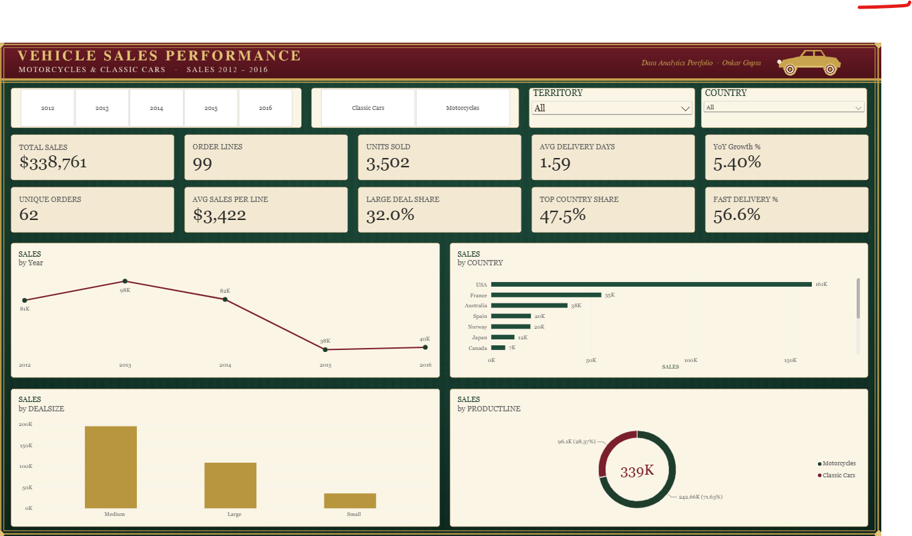

# Vehicle Sales Performance Dashboard (Power BI + Excel + Python)

End-to-end analytics project: raw, messy sales data -> cleaned dataset -> interactive Power BI dashboard with a vintage classic-car theme (plus an Excel version).



## Business questions answered
- How much did we sell, and how did sales trend from 2012 to 2016?
- Which countries, territories and product lines drive revenue?
- Do large deals contribute disproportionately?
- How fast are orders delivered?

## Key findings
- **$338,761** total sales from **3,502 units**, **99 order lines** and **62 unique orders**.
- **USA = 47.5%** of sales. **Motorcycles = 71.6%** of sales (Classic Cars 28.4%).
- Sales peaked in **2013 ($97.5K)**, fell **53% in 2015**, and recovered **+5.4% in 2016**.
- **Large deals are 32%** of sales while being only 26% of order lines.
- Average delivery time is **1.59 days**; **56.6%** of order lines ship within 48 hours.

## Interactivity
Year, Product Line, Territory and Country slicers filter every card and chart. Ten KPI cards, a trend line, a country bar chart, a deal-size chart and a product-line donut.

## Data cleaning (Python and Power Query)
| Issue | Fix |
|---|---|
| 70 date cells had day and month swapped | Swapped back; validated that no delivery precedes its order |
| Territory "NA" (North America) read as missing | Disabled default-NA parsing; renamed to "North America" |
| Blank STATE / POSTALCODE | Filled with "Not applicable" / "Unknown" |
| Repeated order numbers (multi-line orders) | Treated rows as order lines; unique orders reported separately |
| Customer contact names | Removed before publishing |

## Key DAX measures
```
Sales = SUMX(Sheet1, Sheet1[QUANTITYORDERED] * Sheet1[PRICEEACH])

Avg Delivery Days =
AVERAGEX(Sheet1, DATEDIFF(Sheet1[ORDER DATE], Sheet1[DELIVERY DATE], HOUR) / 24)

Fast Delivery % =
VAR FastLines =
    COUNTROWS(FILTER(Sheet1, DATEDIFF(Sheet1[ORDER DATE], Sheet1[DELIVERY DATE], MINUTE) <= 2880))
RETURN DIVIDE(FastLines, [Order Lines])

Top Country Share =
VAR TopSales = MAXX(VALUES(Sheet1[COUNTRY]), [Sales])
RETURN DIVIDE(TopSales, CALCULATE([Sales], ALL(Sheet1)))

YoY Growth % =
VAR Y = MAX(Sheet1[ORDERYEAR])
VAR Cur  = CALCULATE([Sales], FILTER(ALL(Sheet1[ORDERYEAR]), Sheet1[ORDERYEAR] = Y))
VAR Prev = CALCULATE([Sales], FILTER(ALL(Sheet1[ORDERYEAR]), Sheet1[ORDERYEAR] = Y - 1))
RETURN DIVIDE(Cur - Prev, Prev)
```

## Tools
Python (pandas) | Power Query | DAX | Power BI Desktop | Excel (SUMIFS, charts)

## Files
- `Vehicle_Sales_Dashboard.pbix` - Power BI report (open with the free Power BI Desktop)
- `Vehicle_Sales_Dashboard.xlsx` - Excel version of the dashboard, with a cleaning log sheet
- `clean_data.py` - reproducible cleaning script
- `vehicle_sales_clean.csv` - cleaned dataset
- `dashboard.png` - screenshot

## How to reproduce the cleaning
1. Put the raw `vehicle_dataset.xlsx` next to `clean_data.py`
2. `pip install pandas openpyxl`
3. `python clean_data.py`

## Assumptions
Currency is not stated in the source data, so values are shown in $. SALES = QUANTITY x PRICE_EACH. The 2016 figures run to late November.
